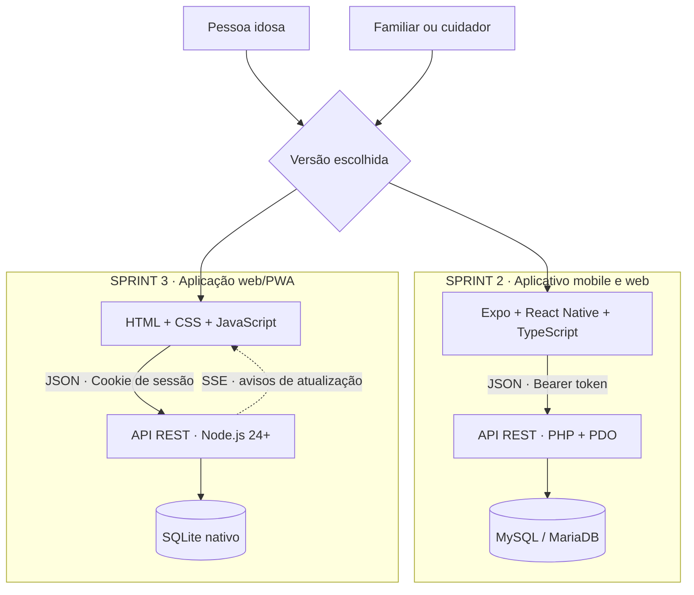

<div align="center">


# CUIDALI

### Tecnologia que aproxima. Cuidado que acompanha.

**Autonomia para a pessoa idosa. Presença para quem cuida.**

[](https://github.com/Pedrooliveira1310/Cuidalli)
[](#experiencia)
[](#acessibilidade)
[](https://github.com/Pedrooliveira1310/Cuidalli/actions/workflows/ci.yml?query=branch%3Asprint-3)

[**Conheça o projeto**](#projeto) · [**Escolha sua versão**](#versoes) · [**Execute**](#executar) · [**Explore a arquitetura**](#arquitetura) · [**Valide**](#qualidade)

<sub>SENAI “A. Jacob Lafer” · Desenvolvimento de Sistemas · Santo André · 2026</sub>

</div>

---

<a id="projeto"></a>

## 01 / O cuidado começa na conexão

Um remédio no horário. Uma consulta lembrada. Um contato de confiança ao alcance de um toque.

O **Cuidali** transforma esses momentos em uma rotina de cuidado compartilhada entre pessoas idosas, familiares e cuidadores. A proposta combina interface acessível, dados persistentes e acompanhamento para apoiar a autonomia de quem recebe cuidado e a presença de quem acompanha.

```text
CUIDALI / CARE CONNECTION
│
├── AUTONOMIA  → uma rotina mais simples para a pessoa idosa
├── PRESENÇA   → informações organizadas para quem acompanha
└── CONFIANÇA  → acesso autorizado e histórico do cuidado
```

<a id="experiencia"></a>

## 02 / Duas perspectivas. Uma rede de apoio.

| Para a pessoa idosa | Para o familiar ou cuidador |
| :--- | :--- |
| Consultar medicamentos e compromissos | Organizar medicamentos, horários e consultas |
| Confirmar a medicação | Acompanhar confirmações e históricos |
| Encontrar contatos de confiança | Manter a rede de apoio atualizada |
| Pedir ajuda pelo SOS | Acompanhar as informações autorizadas |
| Navegar com ações grandes e linguagem clara | Selecionar a pessoa acompanhada sem misturar dados |

As funcionalidades e a forma de vincular os perfis variam por versão. O mapa abaixo identifica o que está implementado em cada branch.

<a id="versoes"></a>

## 03 / Mapa das versões

> **Um README, três branches.** Este documento é compartilhado. Os diretórios, as tecnologias e os comandos pertencem à versão indicada em cada seção.

| Branch | O que você encontra | Onde começar |
| :--- | :--- | :--- |
| [`sprint-1`](https://github.com/Pedrooliveira1310/Cuidalli/tree/sprint-1) | Concepção, requisitos e documento original do projeto | [Documento de concepção](https://github.com/Pedrooliveira1310/Cuidalli/blob/sprint-1/Kannali_Cuidali.docx) |
| [`sprint-2`](https://github.com/Pedrooliveira1310/Cuidalli/tree/sprint-2) | Aplicativo Expo/React Native, API PHP e MySQL/MariaDB; vínculos com consentimento, doses e registros de dor | [Guia completo da sprint 2](https://github.com/Pedrooliveira1310/Cuidalli/blob/sprint-2/docs/GUIA-SPRINT2.md) |
| [`sprint-3`](https://github.com/Pedrooliveira1310/Cuidalli/tree/sprint-3) | Web/PWA, API Node.js e SQLite; SOS no painel, inatividade, assistente por texto/voz e interface redesenhada | [Guia completo da sprint 3](https://github.com/Pedrooliveira1310/Cuidalli/blob/sprint-3/docs/GUIA-SPRINT3.md) |

**As sprints 2 e 3 mantêm implementações distintas.** Padronizar a apresentação não unifica suas APIs, seus bancos ou suas jornadas. Não há migração automática de dados entre elas. A sprint 3 não inclui todos os recursos específicos da sprint 2, como mapa de dor e vínculos por código.

<a id="arquitetura"></a>

## 04 / Por dentro da conexão



| Camada | Sprint 2 | Sprint 3 |
| :--- | :--- | :--- |
| Interface | Expo SDK 58 · React Native · TypeScript | HTML · CSS · JavaScript · PWA |
| API | PHP 8.2+ · PDO | Node.js 24+ · HTTP nativo |
| Banco relacional | MySQL 8 / MariaDB 10.6+ | SQLite via `node:sqlite` |
| Sessão | Bearer token; SecureStore no cliente nativo | Cookie HttpOnly e SameSite |
| Atualização | Manual, retorno ao app e mudança de dia | Avisos via Server-Sent Events |
| Qualidade | Testes unitários, HTTP e Playwright | Node Test Runner, Chromium e GitHub Actions |

<a id="executar"></a>

## 05 / Do repositório à primeira conexão

<details open>
<summary><strong>⚡ Sprint 3 · iniciar a versão web/PWA</strong></summary>

Com **Git e Node.js 24+**, em uma pasta para uma instalação nova:

```sh
git clone --branch sprint-3 https://github.com/Pedrooliveira1310/Cuidalli.git
cd Cuidalli
npm ci
npm start
```

Abra **http://localhost:3000**. O banco é criado em `data/cuidali.sqlite`; não é necessário configurar um servidor de banco separado. Não há conta ou senha padrão.

1. Crie sua conta de familiar/cuidador.
2. Cadastre a pessoa idosa, medicamentos, consultas e um contato de confiança.
3. Selecione **Criar acesso do idoso** e compartilhe as credenciais de forma segura.
4. Entre com esse acesso em outra janela ou aparelho para confirmar doses, consultar o assistente e pedir ajuda.
5. Acompanhe as atualizações e os alertas no painel do cuidador.

Para desenvolvimento, use `npm run dev`. Para variáveis de ambiente, HTTPS, acesso pelo celular, endpoints e backups, siga o [guia da sprint 3](https://github.com/Pedrooliveira1310/Cuidalli/blob/sprint-3/docs/GUIA-SPRINT3.md).

</details>

<details>
<summary><strong>📱 Sprint 2 · iniciar Expo, PHP e banco relacional</strong></summary>

Requer Node.js compatível com `mobile/package.json`, **PHP 8.2+ com PDO/pdo_mysql** e **MySQL 8 ou MariaDB 10.6+** em execução.

```sh
git clone --branch sprint-2 https://github.com/Pedrooliveira1310/Cuidalli.git
cd Cuidalli
```

Configure o banco e os arquivos `backend/.env` e `mobile/.env` conforme o [guia da sprint 2](https://github.com/Pedrooliveira1310/Cuidalli/blob/sprint-2/docs/GUIA-SPRINT2.md). Reutilize os arquivos e as credenciais existentes se já houver instalação.

Em um terminal, a partir da raiz:

```sh
cd backend
php migrate.php
php -S 0.0.0.0:8000 -t public public/index.php
```

Em outro terminal, a partir da raiz:

```sh
cd mobile
npm ci
npm run web -- --port 8081
```

Para web local, a API em `EXPO_PUBLIC_API_URL` deve apontar para `http://127.0.0.1:8000`, e a origem `http://localhost:8081` deve estar no `CORS_ORIGINS` do backend.

No celular, use o IP alcançável do computador em vez de `localhost` e um Expo Go/development build compatível com SDK 58. O [guia completo](https://github.com/Pedrooliveira1310/Cuidalli/blob/sprint-2/docs/GUIA-SPRINT2.md) cobre Windows, Wi-Fi, firewall, migrações, vínculo dos perfis e testes.

</details>

Já possui o repositório? Preserve alterações locais e configurações antes de trocar de branch ou atualizar. Execute os comandos no diretório da versão correspondente.

<a id="acessibilidade"></a>

## 06 / Tecnologia que acolhe

**A experiência foi pensada para reduzir o esforço de usar tecnologia no dia a dia.**

- Ações com áreas de toque de pelo menos **56 px**.
- Rótulos explícitos, foco visível e linguagem em português.
- Identidade visual com azul profundo, superfícies claras e cores de estado.
- Jornadas distintas para quem recebe cuidado e quem acompanha.
- Na sprint 3: acesso prioritário no celular, mostrar/ocultar senha, rascunhos do assistente por pessoa e avisos de conexão.

Verificações básicas de acessibilidade estão nos testes de interface. Elas não equivalem a certificação WCAG ou validação com leitores de tela e usuários idosos.

<a id="qualidade"></a>

## 07 / Qualidade verificável

| Versão | Como verificar | Evidência disponível |
| :--- | :--- | :--- |
| Sprint 2 | `npm run typecheck`, `npm run test:unit` e `npm run export:web` dentro de `mobile`; integração PHP e E2E com banco separado | [Correções e testes](https://github.com/Pedrooliveira1310/Cuidalli/blob/sprint-2/docs/CORRECOES-SPRINT2.md) · [Migração SDK 58](https://github.com/Pedrooliveira1310/Cuidalli/blob/sprint-2/docs/MIGRACAO-SDK58.md) |
| Sprint 3 | `npm run check`, `npm test` e `python tests/browser_smoke.py` na raiz, com as dependências do teste de navegador instaladas | [Registro da integração](https://github.com/Pedrooliveira1310/Cuidalli/blob/sprint-3/TESTES-E-MELHORIAS.md) · [CI](https://github.com/Pedrooliveira1310/Cuidalli/actions/workflows/ci.yml?query=branch%3Asprint-3) |

Na integração documentada da sprint 3, passaram **6 testes de domínio/API** e **1 fluxo completo no Chromium**, incluindo sincronização, SOS, rascunhos por pessoa e reconexão. São evidências daquela execução; o badge mostra o estado informado pelo GitHub Actions.

Os testes da sprint 3 usam bancos temporários. A integração da sprint 2 exige banco exclusivo de testes e autorização explícita de reset. Consulte o guia antes de executá-la sobre qualquer banco.

## 08 / Limites que precisam estar claros

| Recurso | Comportamento real |
| :--- | :--- |
| SOS na sprint 2 | Solicita abertura do discador; não confirma ligação ou atendimento |
| SOS na sprint 3 | Registra alerta no painel e oferece ligação ao contato; requer conexão para registrar |
| Entrega externa de alertas | Sem envio de SMS/WhatsApp ou despacho automático de emergência |
| Assistente na sprint 2 | Atalhos determinísticos de cuidado |
| Assistente na sprint 3 | Respostas programadas com dados cadastrados, texto e voz conforme o navegador; sem LLM ou diagnóstico |
| Lembretes na sprint 3 | Requerem o app aberto; sem push em segundo plano |
| Inatividade na sprint 3 | Requer servidor ativo; verifica o prazo a cada minuto e ao consultar o painel |
| Aplicativo nativo | Expo na sprint 2; a sprint 3 é web/PWA e não entrega APK/IPA |

Senhas e sessões possuem mecanismos de proteção descritos nos guias. Antes de uso real com dados de saúde, configure HTTPS, acesso restrito, consentimento, retenção e backups protegidos. O banco SQLite da sprint 3 não possui criptografia própria.

**O Cuidali é um projeto acadêmico e não substitui atendimento profissional ou serviços de emergência. No Brasil, em emergência médica, ligue 192.**

## 09 / Explore o projeto

| Referência | Acesso |
| :--- | :--- |
| Concepção original | [Documento da sprint 1](https://github.com/Pedrooliveira1310/Cuidalli/blob/sprint-1/Kannali_Cuidali.docx) |
| API e permissões da sprint 2 | [Contratos REST](https://github.com/Pedrooliveira1310/Cuidalli/blob/sprint-2/docs/API.md) |
| Modelo de dados da sprint 2 | [Entidades e relacionamentos](https://github.com/Pedrooliveira1310/Cuidalli/blob/sprint-2/docs/MODELO.md) |
| Operação e API da sprint 3 | [Guia de execução](https://github.com/Pedrooliveira1310/Cuidalli/blob/sprint-3/docs/GUIA-SPRINT3.md) |
| Evolução da interface | [Melhorias e validação](https://github.com/Pedrooliveira1310/Cuidalli/blob/sprint-3/TESTES-E-MELHORIAS.md) |
| Referências visuais | [Capturas da interface](https://github.com/Pedrooliveira1310/Cuidalli/tree/sprint-3/artifacts) |
| Protótipo | [Figma](https://www.figma.com/design/LlvM0OKdhtX7vr7LzgoKRS/Untitled) |

## 10 / Pessoas por trás da tecnologia

| Integrante | Atuação |
| :--- | :--- |
| Pedro de Oliveira | Scrum Master · Backend Engineer |
| Enzo Avanze | Product Owner · Full Stack Developer |
| Isabella Dias da Silva | UI/UX Specialist · Mobile Developer |
| Enzo Yudi Kadooka | Frontend Lead · Mobile Developer |
| Vitor Matheus Canali Pereira | Database Specialist · Backend Developer |
| Evelyn Silva de Lima | QA Engineer · Technical Writer |

Projeto do **4º termo de Desenvolvimento de Sistemas do SENAI “A. Jacob Lafer”**, desenvolvido com metodologia Scrum pela **Kannali Corp**.

---

<div align="center">

### Cada conexão pode ser um gesto de cuidado.

**Cuidali · Conectando gerações, cuidando de vidas.**

<sub>Feito por pessoas. Conectado por tecnologia. Guiado pelo cuidado.</sub>

</div>
