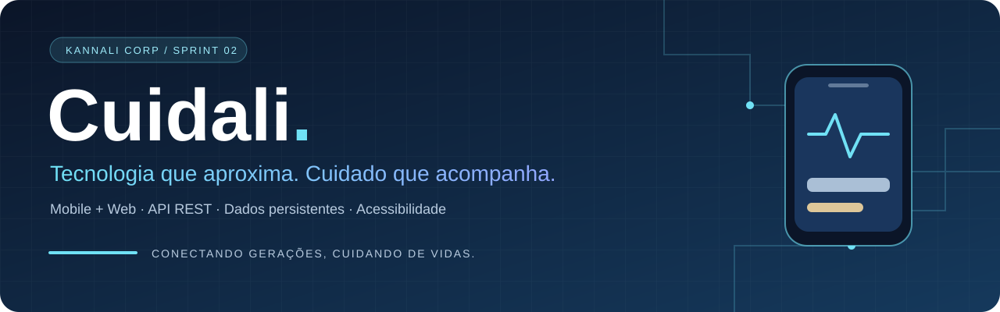
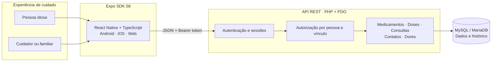
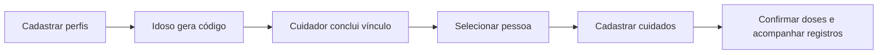

<div align="center">



<br />


**Uma plataforma de cuidado que conecta a autonomia da pessoa idosa à presença de quem cuida.**

[Visão do produto](#visão-do-produto) · [Arquitetura](#arquitetura) · [Executar](#executar-localmente) · [Celular](#testar-no-celular) · [Validação](#qualidade-e-validação) · [Roadmap](#roadmap)

<sub>Kannali Corp · SENAI “A. Jacob Lafer” · Desenvolvimento de Sistemas · 2026</sub>

</div>

---

## Visão do produto

O **Cuidali** reúne medicamentos, consultas, contatos de emergência e registros de dor em uma experiência acessível para pessoas idosas e seus cuidadores. A sprint 2 transforma os requisitos e protótipos da primeira etapa em uma aplicação com autenticação, API REST e banco relacional persistente.

A pessoa idosa acompanha seus cuidados e confirma suas doses. O cuidador acessa os registros somente após uma vinculação autorizada e pode acompanhar mais de uma pessoa, mantendo os dados de cada uma separados.

> **Marco da sprint 2:** jornadas conectadas a dados reais, com permissões verificadas no servidor, histórico de doses e acompanhamento de dor. O assistente oferece atalhos; o SOS abre o discador do dispositivo.

## Experiências conectadas

| Para a pessoa idosa | Para quem cuida |
| :--- | :--- |
| Ver medicamentos e consultas do dia | Selecionar uma pessoa vinculada |
| Confirmar “Já tomei” ou “Ainda não” | Gerenciar medicamentos e seus horários |
| Registrar dor, intensidade e observações | Cadastrar, editar e cancelar consultas |
| Escolher o contato principal do SOS | Acompanhar doses e registros de dor |
| Autorizar ou remover cuidadores | Identificar a leitura de um registro de dor |
| Acessar atalhos de cuidado | Gerenciar contatos de emergência |

### O que dá forma à experiência

- **Confirmação ativa de doses:** “Ainda não” pode virar “Já tomei”; uma dose confirmada não regride nem gera duplicidade.
- **Vínculo com consentimento:** código hexadecimal de 12 caracteres, uso único e validade de 10 minutos. Compartilhá-lo autoriza o cuidador a concluir o vínculo.
- **Dor com contexto:** mapa frente/costas, regiões anatômicas, intensidade de 1 a 10, início, observação e histórico de visualizações.
- **Cuidado sem perder o contexto:** atualização manual, ao retornar ao app e na mudança do dia em São Paulo. Falhas de conexão preservam a última leitura com aviso; dados protegidos são retirados diante de respostas 401, 403 ou 404.
- **Formulários adequados aos dados:** telefone filtrado ao digitar e colar, datas brasileiras e ISO, senha visível/oculta e de 1 a 24 horários individuais por medicamento.
- **Acessibilidade na interface:** textos ampliados, contraste, áreas de ação de pelo menos 56 px e seleção textual das regiões do corpo como alternativa ao mapa.

## Arquitetura



| Camada | Tecnologia | Responsabilidade |
| :--- | :--- | :--- |
| Aplicativo | Expo **58.0.17**, React Native **0.88.0**, React **19.3.0** | Interface mobile e web |
| Tipagem | TypeScript **5.9** | Contratos e validação estática |
| Sessão nativa | Expo SecureStore | Persistência segura do token no Android/iOS |
| API | PHP **8.2+**, orientação a objetos e PDO | Regras de negócio, autenticação e autorização |
| Persistência | MySQL **8** ou MariaDB **10.6+** | Relacionamentos, transações e histórico |
| Testes | Node Test Runner, Playwright e integração HTTP em PHP | Regressões, interface e comportamento da API |

### Organização do repositório

```text
Cuidalli/
├── mobile/
│   ├── App.tsx                 # Jornadas, navegação e telas
│   ├── src/                    # API, UI e validações compartilhadas
│   ├── tests/                  # Testes unitários e de interface
│   └── .env.example            # URL pública da API
├── backend/
│   ├── public/index.php        # Entrada HTTP da API
│   ├── src/                    # Bootstrap e regras da API
│   ├── sql/                    # Migrações versionadas
│   ├── tests/integration.php   # Integração com banco separado
│   └── migrate.php             # Aplicação das migrações pendentes
├── docs/                       # API, modelo, entregas e histórico
└── scripts/                    # Helpers do ambiente cloud
```

## Executar localmente

### 1 · Preparar as ferramentas

- **Node.js:** 22.13+ na linha 22, 24.3+ na linha 24 ou outra versão aceita por `mobile/package.json` → `engines`. Validação realizada com Node 24.19.
- **PHP 8.2+**, com as extensões `PDO` e `pdo_mysql`.
- **MySQL 8** ou **MariaDB 10.6+** em execução.
- **Expo Go compatível com SDK 58** para testar no celular, ou development build correspondente.

No Windows, o MySQL pode ser iniciado pelo XAMPP. Confira qual PHP está no PATH:

```cmd
where php
php -v
php -m | findstr /I "PDO pdo_mysql"
```

### 2 · Obter a sprint 2

Para uma instalação nova:

```sh
git clone --branch sprint-2 https://github.com/Pedrooliveira1310/Cuidalli.git
cd Cuidalli
```

Se o projeto já existe no computador, entre na pasta dele e use:

```sh
git switch sprint-2
git pull --ff-only origin sprint-2
```

Se o Git apontar alterações locais, preserve-as antes de atualizar. Mantenha seus arquivos `.env`, credenciais e dados existentes. A atualização para o SDK 58 está detalhada em [Migração para SDK 58](docs/MIGRACAO-SDK58.md).

### 3 · Conectar o banco

Para um banco novo, execute em uma sessão administrativa do MySQL. Substitua a senha ilustrativa por uma senha local:

```sql
CREATE DATABASE IF NOT EXISTS cuidali
  CHARACTER SET utf8mb4 COLLATE utf8mb4_unicode_ci;

CREATE USER IF NOT EXISTS 'cuidali'@'127.0.0.1'
  IDENTIFIED BY 'SUBSTITUA_POR_SENHA_LOCAL';

GRANT ALL PRIVILEGES ON cuidali.* TO 'cuidali'@'127.0.0.1';
```

Se banco e usuário já existem, reutilize suas credenciais. `CREATE USER IF NOT EXISTS` não altera a senha de um usuário existente. A conta deve ter acesso ao banco a partir do host usado na conexão.

**No CMD do Windows**, dentro de `backend`:

```cmd
cd backend
if not exist .env copy .env.example .env
notepad .env
```

**No Linux/macOS**, dentro de `backend`, copie o exemplo apenas se ainda não houver configuração:

```sh
cd backend
[ -f .env ] || cp .env.example .env
```

Edite o arquivo com os dados do seu MySQL:

```dotenv
DB_HOST=127.0.0.1
DB_PORT=3306
DB_NAME=cuidali
DB_USER=cuidali
DB_PASSWORD=SUA_SENHA_LOCAL
CORS_ORIGINS=http://localhost:8081,http://localhost:19006
SESSION_HOURS=168
APP_TIMEZONE=America/Sao_Paulo
```

> O `.env` precisa conter os valores e estar salvo. Um arquivo vazio não configura a conexão. Não versione senhas nem compartilhe o conteúdo desse arquivo.

Aplique as migrações e inicie a API, ainda em `backend`:

```sh
php migrate.php
php -S 0.0.0.0:8000 -t public public/index.php
```

Mantenha o terminal aberto. `GET /health` verifica a conexão com o banco e deve retornar `"status":"ok"`.

O migrador registra as versões em `schema_migrations` e aplica apenas as pendentes. Não recria as tabelas nem apaga dados existentes. Mudanças futuras no schema devem usar novos arquivos SQL numerados.

### 4 · Iniciar o aplicativo

Em outro terminal, partindo da raiz do repositório, entre em `mobile`. **No CMD do Windows:**

```cmd
cd mobile
if not exist .env copy .env.example .env
notepad .env
```

**No Linux/macOS:**

```sh
cd mobile
[ -f .env ] || cp .env.example .env
```

Para usar no navegador do computador, configure:

```dotenv
EXPO_PUBLIC_API_URL=http://127.0.0.1:8000
```

Instale as versões do lockfile e execute:

```sh
npm ci
npm run web -- --port 8081
```

Abra `http://localhost:8081`. A origem exata deve estar em `CORS_ORIGINS` no backend. Não acrescente `/public` à URL da API ao usar o servidor PHP mostrado acima.

## Testar no celular

1. Conecte o celular e o computador à mesma rede Wi-Fi.
2. No Windows, execute `ipconfig` e encontre o **IPv4 do adaptador Wi-Fi conectado**, evitando o endereço de um adaptador virtual.
3. Configure `mobile/.env` com o IP do computador. Exemplo:

   ```dotenv
   EXPO_PUBLIC_API_URL=http://192.168.1.10:8000
   ```

4. Com a API ativa, abra `http://192.168.1.10:8000/health` no navegador do celular. Substitua o IP de exemplo pelo seu. Prossiga quando aparecer `"status":"ok"`.
5. Se não abrir, confira a rede e permita o PHP na porta 8000 no Firewall do Windows para **redes privadas**.
6. Pare qualquer Expo anterior com **Ctrl+C**. Dentro de `mobile`, execute:

   ```sh
   npx expo start --clear
   ```

7. Abra o novo QR code no Expo Go compatível com **SDK 58**. No Android, use o leitor do Expo Go; no iPhone, use a câmera.

No celular, `localhost` e `127.0.0.1` apontam para o próprio telefone. O túnel do Expo não torna a API PHP local automaticamente acessível. Reinicie o Expo sempre que alterar `EXPO_PUBLIC_API_URL`. No emulador Android padrão, a API do computador pode ser acessada por `http://10.0.2.2:8000`.

## Primeira jornada



Não há conta padrão nem seed obrigatório. Use dados fictícios durante a avaliação:

1. Cadastre uma pessoa idosa e um cuidador. O cadastro do idoso também pede um contato de emergência.
2. No perfil do idoso, abra **Cuidados → Vínculos** e gere um código.
3. No perfil do cuidador, informe o código e selecione a pessoa vinculada.
4. Cadastre medicamentos com horários e período de uso, consultas e contatos.
5. Entre como idoso para confirmar doses, registrar dor e escolher o contato principal do SOS.
6. Volte ao cuidador para acompanhar os registros e identificar visualizações de dor.

## Sessão, permissões e histórico

| Mecanismo | Comportamento implementado |
| :--- | :--- |
| Autenticação | Senhas com `password_hash`/`password_verify`; token aleatório por sessão |
| Tokens no banco | Armazenados por hash SHA-256 |
| Cliente nativo | Token no SecureStore; nenhuma senha armazenada no app |
| Cliente web | Token somente em memória; recarregar exige novo login |
| Autorização | Identidade, perfil, vínculo e pessoa da URL verificados na API |
| Saída offline | Encerra a sessão local e informa se a revogação no servidor falhou |
| Sessões concorrentes | Um 401 atrasado de uma sessão antiga não encerra um login mais recente |
| Medicamentos | Desativação preserva o histórico; editar um desativado retorna conflito |
| Consultas | Cancelamento preserva o registro; editar uma cancelada retorna conflito |
| Datas | Consultas interpretadas em São Paulo e persistidas em UTC |
| Limites de texto | Caracteres Unicode; senha com limite de 72 bytes |

A API também limita tentativas de autenticação e operações de códigos. CORS usa origens explícitas e não substitui autenticação. Para detalhes de endpoints e permissões, consulte [API REST](docs/API.md).

## Qualidade e validação

### Evidências registradas

| Verificação | Resultado documentado |
| :--- | :--- |
| TypeScript | Aprovado |
| Sintaxe PHP | Cinco arquivos aprovados |
| Testes unitários compartilhados | **5 testes aprovados** |
| Integração HTTP com MariaDB | **129 verificações aprovadas** |
| Playwright / Chromium | **13 testes aprovados** |
| Viewports mobile no navegador | **390 × 844** e **320 × 740** |
| Exportação web | Aprovada com SDK 58 |
| Exportação Android / Hermes | Aprovada com SDK 58 |

As evidências são das execuções registradas em [Correções da sprint 2](docs/CORRECOES-SPRINT2.md) e [Migração para SDK 58](docs/MIGRACAO-SDK58.md), não de um status automático de CI. A integração HTTP foi validada com PHP 8.4 e MariaDB, incluindo o processo PHP em UTC; não houve execução com PHP 8.2 ou MySQL 8 nesta entrega.

> Exportar um bundle Android não produz APK nem comprova funcionamento no dispositivo. Os testes de interface foram executados no navegador. SecureStore, teclado nativo, botão Voltar e discador ainda precisam de validação em aparelho físico ou emulador.

### Executar as verificações

Dentro de `mobile`:

```sh
npm run typecheck
npm run test:unit
npm run export:web
```

<details>
<summary><strong>Integração HTTP · banco isolado</strong></summary>

Crie um banco exclusivo `cuidali_test` e conceda acesso ao usuário configurado. O teste limpa os dados desse banco e exige `TEST_ALLOW_RESET=1`; não use um banco com dados que precisam ser preservados.

**Bash**, dentro de `backend`:

```sh
DB_NAME=cuidali_test php migrate.php
DB_NAME=cuidali_test php -S 127.0.0.1:8001 -t public public/index.php
```

Em outro terminal, com a mesma configuração `DB_*`:

```sh
DB_NAME=cuidali_test TEST_ALLOW_RESET=1 php tests/integration.php
```

**PowerShell**, dentro de `backend`:

```powershell
$env:DB_NAME = 'cuidali_test'
php migrate.php
php -S 127.0.0.1:8001 -t public public/index.php
```

Em outro PowerShell, também dentro de `backend`:

```powershell
$env:DB_NAME = 'cuidali_test'
$env:TEST_ALLOW_RESET = '1'
php tests/integration.php
Remove-Item Env:TEST_ALLOW_RESET
Remove-Item Env:DB_NAME
```

O servidor de testes deve usar o mesmo banco e as mesmas credenciais do runner. Não execute a integração destrutiva enquanto os E2E estiverem em andamento.

</details>

<details>
<summary><strong>Playwright · interface com API e banco reais</strong></summary>

Mantenha a API de testes ativa em `8001`, conectada ao banco separado `cuidali_test`. Confirme `http://localhost:8081` em `CORS_ORIGINS` desse servidor.

Dentro de `mobile`, configure temporariamente `EXPO_PUBLIC_API_URL=http://127.0.0.1:8001` no `.env` e exporte novamente:

```sh
npm run export:web
python -m http.server 8081 --directory dist
```

Em outro terminal, dentro de `mobile`:

```sh
npx playwright install chromium
```

No **Bash**:

```sh
E2E_API_URL=http://127.0.0.1:8001 npm run test:e2e
```

No **PowerShell**:

```powershell
$env:E2E_API_URL = 'http://127.0.0.1:8001'
npm run test:e2e
Remove-Item Env:E2E_API_URL
```

Use `E2E_WEB_URL` se a interface estiver em outra origem. No Linux, `CHROMIUM_PATH=/usr/bin/chromium` permite usar um Chromium já instalado. Os E2E criam registros fictícios; a API do bundle e a API informada ao runner precisam apontar para o mesmo servidor de testes. Ao voltar ao uso normal, restaure a URL de desenvolvimento no `.env` e reinicie o Expo ou exporte novamente.

</details>

## Solução rápida de problemas

| Sintoma | O que conferir |
| :--- | :--- |
| `not a git repository` | Entre na pasta `Cuidalli` antes dos comandos Git |
| Expo Go informa SDK 55 | Atualize `sprint-2`, execute `npm ci` e confirme a versão com `node -p "require('expo/package.json').version"`; deve retornar `58.0.17` |
| Git impede atualização por alterações locais | Guarde seu trabalho antes do pull; não descarte arquivos ou restaure dependências antigas sem comparação |
| `Access denied ... using password: NO` | O `.env` do backend pode estar vazio ou sem `DB_PASSWORD`; salve as credenciais corretas |
| `could not find driver` | Ative `pdo_mysql` no PHP usado pelo terminal |
| Não foi possível conectar à API | Confirme o servidor PHP, o IP no `.env` do mobile e `/health` no dispositivo |
| `/health` abre no computador, mas não no celular | Confira Wi-Fi, IPv4 correto, firewall e servidor PHP ligado em `0.0.0.0` |
| API funciona no celular, mas falha na web | Confira a origem exata em `CORS_ORIGINS` e reinicie a API |
| Alterar o `.env` não muda o destino | Reinicie o Expo com `--clear` ou gere novamente o bundle web |

## Roadmap

| Etapa | Foco | Situação |
| :--- | :--- | :--- |
| Sprint 1 | Requisitos, modelagem e protótipo | Documentação preservada |
| Sprint 2 | Aplicativo, API, persistência, vínculos e jornadas de cuidado | Implementada; validações documentadas |
| Sprint 3 | Evolução do produto e integrações | Planejada |

**Previsto para evolução:** notificações remotas SOS, acompanhamento de inatividade, assistente conversacional com IA/voz, aplicativo do relógio e integrações de agenda. Recuperação de senha e biometria dependem de definição de escopo.

Nesta sprint, o SOS solicita a abertura do discador e não confirma ligação, atendimento ou envio de alerta remoto. Registrar dor disponibiliza o registro aos cuidadores vinculados, sem notificação automática. O assistente atual oferece atalhos determinísticos, sem IA ou reconhecimento de voz.

## Documentação

| Documento | Conteúdo |
| :--- | :--- |
| [API e permissões](docs/API.md) | Rotas, contratos, erros e autorização |
| [Modelo de dados](docs/MODELO.md) | Entidades e relacionamentos |
| [Correções da sprint 2](docs/CORRECOES-SPRINT2.md) | Revisão funcional, testes e limitações |
| [Migração para SDK 58](docs/MIGRACAO-SDK58.md) | Dependências e atualização local |
| [Entrega original](docs/ENTREGA.md) | Histórico técnico da implementação |
| [README da sprint 1](docs/README-SPRINT1.md) | Visão inicial e identidade visual |
| [Documento de requisitos](Kannali_Cuidali.docx) | Material original do projeto |
| [Protótipo no Figma](https://www.figma.com/design/LlvM0OKdhtX7vr7LzgoKRS/Untitled) | Referência de interface |

<details>
<summary><strong>Ambiente cloud · helpers de desenvolvimento</strong></summary>

No Debian 13 do ambiente Codex, `bash scripts/cloud-install.sh` prepara PHP/MariaDB em `/workspace/cuidali-tools`, dependências npm e schemas. O helper verifica assinaturas/checksums pelo APT, mantém os dados nessa pasta e não altera o PHP global.

Em terminais separados:

```sh
bash scripts/cloud-start.sh api
bash scripts/cloud-start.sh mobile
```

Para iniciar somente a API dos testes:

```sh
bash scripts/cloud-start.sh test-api
```

O helper foi feito para o ambiente acadêmico isolado, com contas locais sem senha e banco ligado a `127.0.0.1:3307`. Não o use em produção ou servidor compartilhado. Para computadores pessoais, siga a instalação padrão deste README com suas credenciais.

Dependências e dados podem persistir no snapshot; MariaDB, API e Metro precisam ser reiniciados em uma nova tarefa. Cada tarefa cloud já é isolada: não crie worktree para o uso normal. O Metro do helper usa `--localhost`; teste em celular físico exige um host alcançável e a configuração de rede descrita acima.

</details>

## Kannali Corp

| Integrante | Atuação |
| :--- | :--- |
| Pedro de Oliveira | Scrum Master · Backend Engineer |
| Enzo Avanze | Product Owner · Full Stack Developer |
| Isabella Dias da Silva | UI/UX Specialist · Mobile Developer |
| Enzo Yudi Kadooka | Frontend Lead · Mobile Developer |
| Vitor Matheus Canali Pereira | Database Specialist · Backend Developer |
| Evelyn Silva de Lima | QA Engineer · Technical Writer |

Projeto acadêmico do 4º termo do curso Técnico em Desenvolvimento de Sistemas do **SENAI “A. Jacob Lafer”**, Santo André, desenvolvido com metodologia Scrum. Antes de uso com dados reais de saúde, são necessárias validação em dispositivos, revisão de segurança/LGPD e definição de consentimento, retenção e backup. O servidor embutido do PHP é para desenvolvimento; em produção, use HTTPS e raiz pública exclusiva em `backend/public`.

---

<div align="center">

**Cuidali · Conectando gerações, cuidando de vidas.**

<sub>Uma entrega da Kannali Corp · Sprint 02</sub>

</div>
