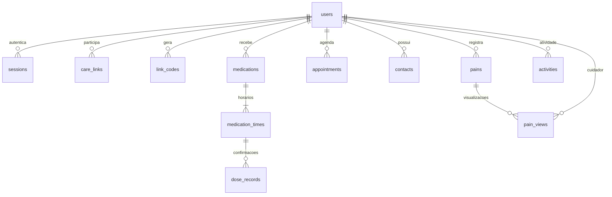

# Modelo de dados atualizado

SQL versionado em `backend/sql`, aplicado por `backend/migrate.php`. MySQL/MariaDB, InnoDB, utf8mb4. Horários de medicação são horários civis de São Paulo; datas de doses são civis; timestamps de atividades, sessões, consultas e dores são UTC.

`users.role` distingue idoso (`elder`) e cuidador (`caregiver`). Perfil não é alterável via API. As duas FKs de care_links apontam para users; a aplicação garante o papel correto na geração/resgate. Não é necessário duplicar nome/telefone em tabelas de perfil vazias: os atributos comuns ficam na entidade única.

## Evolução do dicionário da sprint 1

| Sprint 1 | Sprint 2 e motivo |
|---|---|
| Idoso sem senha; Familiar_Cuidador com e-mail/senha | users comum com telefone único, password_hash, nome e nascimento. Ambos autenticam; nome não identifica conta. E-mail e endereço não são exigidos pela sprint 2. |
| Familiar_Cuidador.id_idoso (um idoso) | care_links com chave composta elder_id/caregiver_id, permite múltiplos vínculos nos dois sentidos. Exclusão revoga acesso, sem apagar cuidados. |
| Sem sessões | sessions com token_hash PK, expiração e FK do usuário; logout exclui sessão. |
| Sem convite seguro | link_codes com hash único, dono, expiração, used_at e revoked_at; uso transacional, um vínculo por código. |
| Medicamento.horario único | medications para tratamento e medication_times para múltiplos horários. Datas início/fim e active. Horários removidos são desativados, não apagados. |
| Confirmacao com data_hora e status nao_tomei | dose_records com data prevista e FK do horário; UNIQUE(time_id,dose_date), status pending/taken, recorded_at separado. “Ainda não” pode evoluir para tomado. |
| Consulta sem médico | appointments com doctor, specialty, scheduled_at UTC, location e cancelled; cancelamento preserva registro. |
| Contato sem principal | contacts com is_primary. Alterações bloqueiam a linha do usuário e atualizam o principal em transação, impedindo dois principais pela API. Exclusão do principal exige nova escolha. |
| Sem registro de dor | pains com frente/costas, região anatômica, tipo, intensidade 1–10, início, observação e timestamp; pain_views com chave composta dor/cuidador e data da primeira visualização. |
| Historico_Interacao genérico | activities registra ações reais e ator. Home mostra última atividade **do idoso**, sem inventar estado clínico. Assistente por atalhos não gera conversa fictícia. |
| Alerta_Emergencia com status genérico | Não utilizado nesta sprint: abrir discador não comprova emergência recebida ou ligação completada. Eventos de entrega/notificações serão modelados na sprint 3. |

## Integridade e histórico

- PKs BIGINT UNSIGNED e FKs em todos os relacionamentos; índices por idoso e data, unicidade de telefone, vínculo, código, horário e confirmação.
- Não existe exclusão de conta nesta API. FKs de cuidados restringem exclusão para evitar perda acidental de histórico. Sessões podem ser removidas com o usuário.
- Medicamentos/horários e consultas são desativados/cancelados. Confirmações permanecem consultáveis no dashboard após desativação. Edição da prescrição atual altera nome/dosagem exibidos inclusive no histórico; versionamento de prescrições clínicas é uma evolução futura, e esta versão não é prontuário clínico.
- `pain_views` preserva o cuidador e a data mesmo após desvinculação; o ex-cuidador perde acesso aos registros. Dor não pode ser editada ou apagada nesta API.
- Os contatos são excluídos fisicamente; não existem alertas remotos associados nesta sprint.
- Alterações futuras entram em `002_*.sql` etc. O migrador não altera o documento original nem migra automaticamente bancos de uma aplicação anterior: o repositório tinha somente o DOCX e README.
